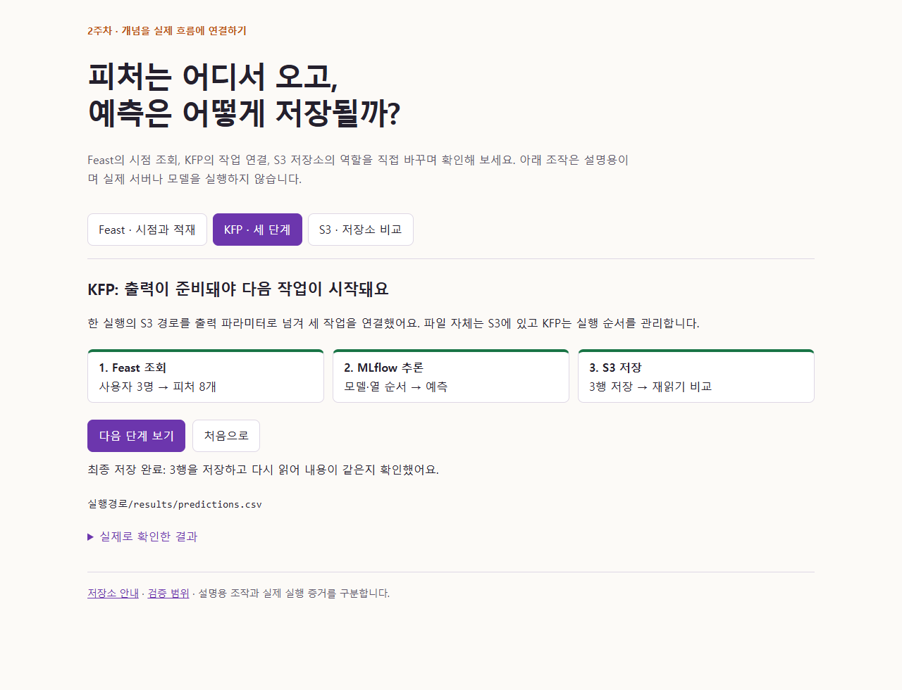

# 인터랙티브 설명

[mlops-explorer.html](mlops-explorer.html)을 내려받아 브라우저로 열면 네트워크 없이 조작할 수 있습니다. GitHub 파일 보기 화면은 HTML을 실행하지 않으므로 로컬 파일로 열어야 합니다.

- Feast: 기준 시각·과거/온라인 조회·Redis 적재 여부를 바꾸며 반환값 차이를 확인합니다.
- KFP: 조회·추론·저장의 세 단계를 진행하며 중간 파일과 최종 파일의 위치를 확인합니다.
- 저장소: SeaweedFS·Garage·VersityGW의 역할·경로와 실제 검사 결과를 비교합니다.

조작은 설명용 시뮬레이션이며 실제 서버를 실행하지 않습니다. 원본 데이터의 실제 시간 변화가 아닌 가상 피처 이력도 명시했습니다. 데스크톱과 390px 모바일, 어두운 테마, 키보드·주요 조작·가로 넘침·자바스크립트 오류를 검사했습니다.

